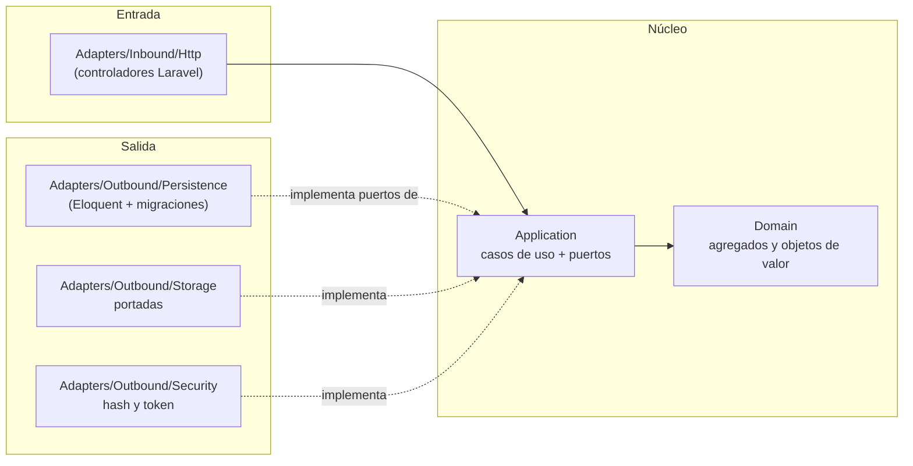
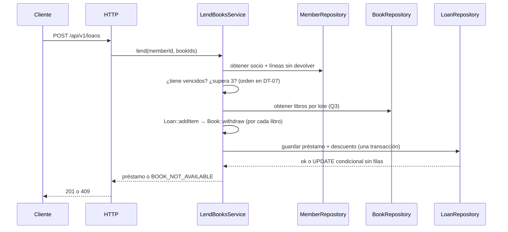

# Arquitectura — Manager Library (Laravel + React)

Arquitectura **hexagonal** (puertos y adaptadores). Las reglas de dependencia son los artículos I a III de [`constitution.md`](constitution.md).

## 1. Capas y dependencias



Las flechas de dependencia apuntan **hacia adentro**. `Bootstrap` es el único que ve las dos mitades.

## 2. Estructura de carpetas (repo `api`)

```text
app/
├── Domain/              # Book, Loan, LoanItem, Member, User; Isbn, Quantity, DateRange
├── Application/
│   ├── Ports/Outbound/  # BookRepository, LoanRepository, MemberRepository, UserRepository,
│   │                    # ReportReader, Clock, PasswordHasher, TokenIssuer, CoverStorage
│   └── Services/        # LendBooksService, ReturnItemService, CreateBookService, SearchBooksService,
│                        # OverdueService, MostBorrowedReportService, LoginService, CreateLibrarianService
├── Adapters/
│   ├── Inbound/Http/    # controladores, form requests, middleware de rol, manejo de errores
│   └── Outbound/        # Persistence/ (modelos Eloquent), Storage/, Security/
└── Bootstrap/           # PortBindingsServiceProvider.php: único punto de composición
database/migrations/     # todo el DDL del esquema `library` y la semilla de categorías
tests/                   # Unit (dominio), Application, Integration, Contract, Architecture
```

## 3. Estructura del frontend (repo `app`)

```text
src/
├── api/        # cliente HTTP único: añade el token y traduce el cuerpo de error
├── auth/       # contexto de sesión, rutas protegidas por rol
├── features/   # login, books, members, loans, overdue, report
├── components/ # piezas reutilizables sin lógica de negocio
└── main.tsx
```

## 4. Agregados

| Raíz | Contiene | Invariantes que defiende |
|---|---|---|
| `Book` | `Isbn`, copias totales y disponibles, baja lógica | disponibles entre 0 y total; total ≥ 1; título no vacío |
| `Loan` | colección de `LoanItem` | 1 a 3 líneas; sin libro repetido; vencimiento a 14 días; inmutable salvo devolución |
| `Member` | documento | documento obligatorio y único |
| `User` | rol, hash | nombre normalizado; rol en (`admin`, `librarian`) |

`Loan::addItem` llama a `Book::withdraw` antes de añadir la línea: descontar el ejemplar y crear la línea son **una sola operación**.
`Loan::returnItem` llama a `Book::restock` una sola vez por línea.

## 5. Flujo: registrar un préstamo



## 6. Errores

El dominio y la aplicación lanzan excepciones propias (`BookNotAvailable`, `MemberHasOverdue`, `MemberLimitExceeded`, …). **Solo** el manejador
de excepciones del adaptador HTTP las traduce al cuerpo único y al código de estado de [`api-contract.md`](api-contract.md). Un error de
framework nunca llega al cliente: el manejador por defecto de Laravel se reemplaza.

## 7. Qué no hay

Sin eventos, sin colas, sin caché, sin sesiones, sin microservicios, sin multi-tenencia. Se añaden si un requisito lo pide, no antes.
